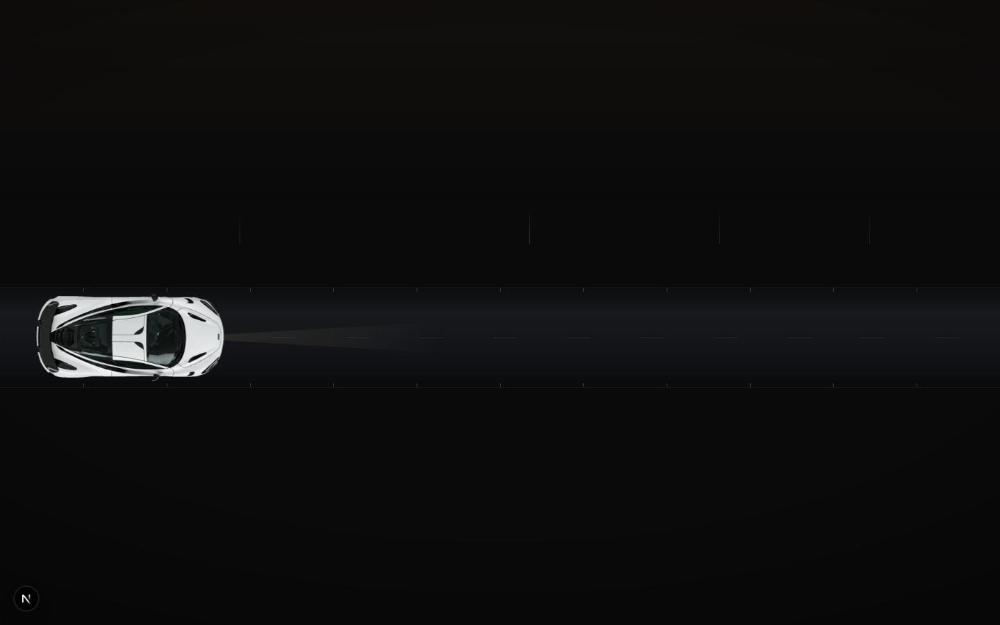
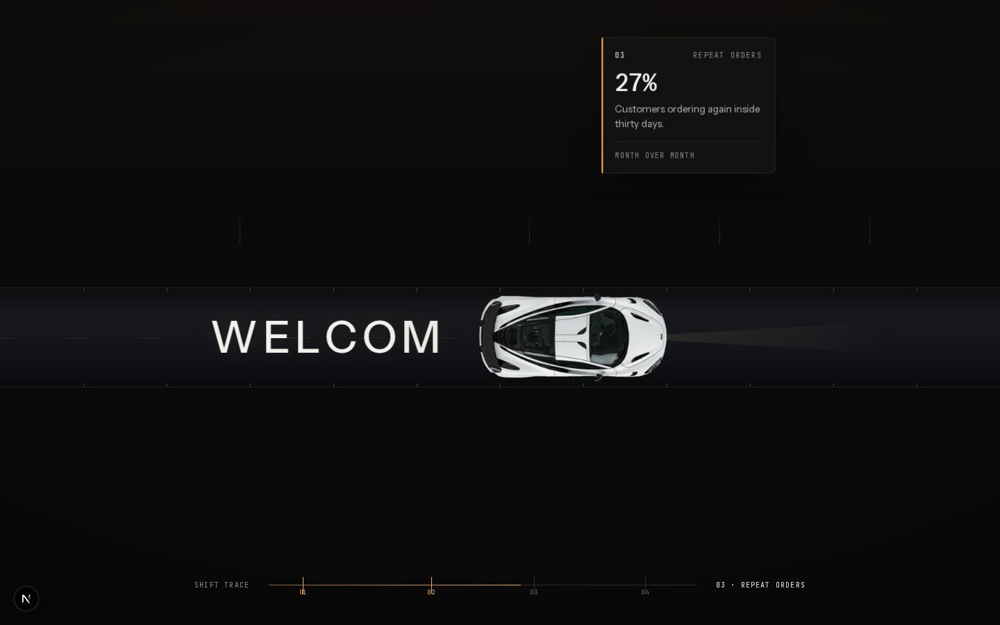
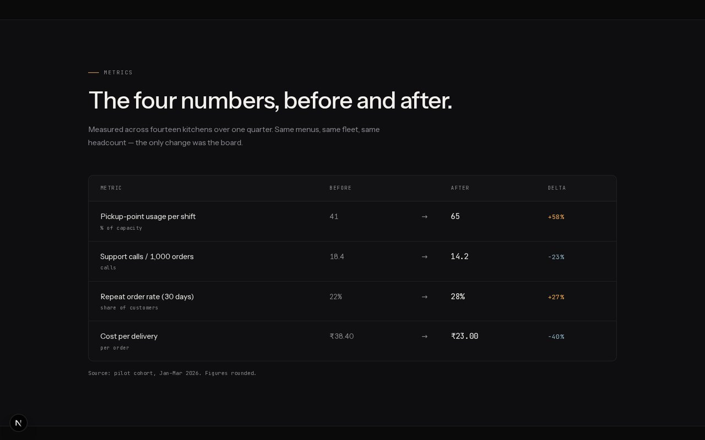
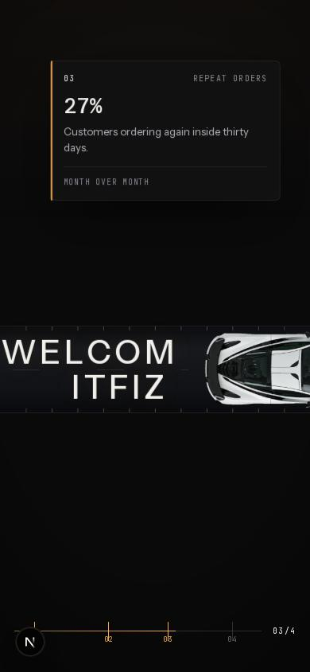

# ITFIZZ — Scroll-Driven Hero Section

A scroll-driven hero for a fictional dispatch-ops product: a **sticky stage** pins the first
screen while a top-down car **drives across the road in step with your scroll**, writing the
letter-spaced `W E L C O M E  I T F I Z Z` headline onto the asphalt as it goes — a glyph only
comes up once the car has already passed over it — and surfacing an impact metric at each stop.
Below it the page carries on as a real landing page — how it works, the metrics the headline
numbers come from, a customer quote, a pilot call to action, a footer.

Built with **Next.js (static export) + React + Tailwind CSS + GSAP ScrollTrigger**. No other
animation libraries, no canvas, no WebGL.

| | |
| --- | --- |
| **Live demo** | `https://<your-username>.github.io/itfizz-scroll-hero/` |
| **Repository** | `https://github.com/<your-username>/itfizz-scroll-hero` |
| **Reference** | https://paraschaturvedi.github.io/car-scroll-animation |
| **Stack** | Next.js 16 · React 19 · Tailwind CSS 4 · GSAP 3 (ScrollTrigger) |









> Replace the two placeholder URLs at the top with your real ones after pushing — they are the two
> links the assignment asks for.

---

## What it does (requirement by requirement)

| Requirement | Where it lives |
| --- | --- |
| **Hero occupies the first screen** | `.viewport` is a `100svh` sticky stage; the headline, the road + car, the KPI signs, the stats and the HUD all live inside that single frame. |
| **Letter-spaced `WELCOME ITZFIZZ`** | One `<span class="headline__letter">` per glyph, `letter-spacing: 0.1em`, a wider word gap (`app/scene.css`). |
| **Impact metrics / statistics** | Four KPIs on the first screen's closing beat, each with its measurement window (`HERO_STATS`), then the same four numbers expanded with before → after values in the metrics table. |
| **First screen** | Nothing on it but the car and its road — no nav, no headline, no stats. The nav and the lede/stats only land at the end of the run; the "scroll" cue appears only if you sit still for ~2.8 s (`HINT_DELAY_MS`). |
| **Initial load animation** | A paused GSAP timeline fades the loading veil and eases the sprite in once the car image is decoded. Everything else waits for scroll. |
| **The headline writes itself** | The glyphs live *on* the road, and the car drives over them. A glyph starts to come up only once the car's trailing light pool has swept past it (`glow = x − carW × 0.14`), so the car always leads and the phrase collects in its wake — never a letter ahead of the car. |
| **Report at the end of the run** | Once the car has cleared the last word, the lede and the four figures land one after another. |
| **Scroll-based animation** | One scrubbed tween maps page scroll to a single progress value `0 → 1`; the car's `x` is `startX + drive(t) × travel`, where the run itself is measured from the headline. Nothing is time-based autoplay. |
| **Easing / interpolation** | `scrub: 0.6` gives the motion inertia decoupled from the scroll event rate; `driveEase()` front-loads the drive so the car settles as it finishes the last word, and windowed `range()` / `emerge()` helpers plus `easeOutCubic` shape every staged reveal. |
| **Smooth & performant** | Only `transform` + `opacity` are animated, geometry is measured once per resize, no layout reads inside the render loop. Measured **16.67 ms average frame (locked 60 fps), p95 16.8 ms, 0 layout shifts** across a scripted full-scroll pass in headless Chromium. |
| **Tech stack** | HTML/CSS/JS (JSX + CSS), GSAP + ScrollTrigger, Next.js/React, Tailwind. |
| **Bonus** | Static export deployable to GitHub Pages (branch `/docs` **or** GitHub Actions), an asset pipeline script, a low-power fallback and an accessibility pass. |

---

## Getting started (VS Code)

```bash
# 1. open the folder
code itfizz-scroll-hero

# 2. install dependencies (Node 20 or newer)
npm install

# 3. start the dev server
npm run dev            # → http://localhost:3000
```

VS Code will offer to install the four recommended extensions
(`.vscode/extensions.json`): Tailwind CSS IntelliSense, Prettier, ESLint and the TypeScript
nightly. Save any file and Prettier formats it (`.vscode/settings.json` + `.prettierrc.json`).

| Script | What it does |
| --- | --- |
| `npm run dev` | Next.js dev server with hot reload |
| `npm run build` | Production build + static export into `out/` (Turbopack) |
| `npm run build:webpack` | Same build via webpack — lower peak RAM for small machines |
| `npm run preview` | Serve the exported site exactly as GitHub Pages would (`/itfizz-scroll-hero/`) |
| `npm run deploy:gh` | Export **and** package into `docs/` with a `.nojekyll` file, ready to push |
| `LOW_MEMORY=1 npm run deploy:gh` | Same, but builds with webpack if Turbopack runs out of memory |
| `npm run assets` | Re-run the car-image pipeline in `tools/process-car.py` (needs `python3` + Pillow + numpy) |
| `npm run typecheck` | `tsc --noEmit` |
| `npm run format` / `format:check` | Run Prettier over the source |

### Where to change what

| I want to change… | Edit this |
| --- | --- |
| Headline / stats / card copy / nav / footer / all numbers | `lib/content.ts` — every string on the page is there |
| The rhythm of the story: run, stops, report | the `Tunables` block at the top of `components/HeroScene.tsx` (`DRIVE`, `REPORT`, `SCRUB`) |
| When a KPI sign appears, on which stretch of the run | `progress` (and `align`) on each entry in `MILESTONES` in `lib/content.ts` |
| How far behind the car a letter lights up, how fast it fades in | `GLOW_LAG`, `GLYPH_FADE` in the same block |
| Where the car starts and how far past the last word it stops | `RUN_INSET`, `RUN_OUT`, `driveEase()` |
| How long before the "scroll" cue appears — or switch it off | `HINT_DELAY_MS` (`0` = immediately, `Infinity` = never) |
| Colours, fonts, buttons, section typography | the `@theme` tokens at the top of `app/globals.css` |
| Stage geometry (road thickness/position, car size, card widths, HUD) | `app/scene.css` — the `--road-*` / `--car-*` custom properties on `.viewport` |
| A new section below the hero | add a component in `components/`, then drop it into `app/page.tsx` |
| The car image | replace `raw/car-top-raw.png` and run `npm run assets` |
| Page title / SEO description / fonts | `app/layout.tsx` |

### Common edits, in one line each

```ts
// components/HeroScene.tsx

// letters light up further behind the car (larger) or closer to its nose (smaller)
const GLOW_LAG = 0.14;      // car lengths behind the front bumper

// softer, more gradual letter reveal
const GLYPH_FADE = 0.04;    // → 0.08 spreads each glyph over more scroll

// start the car further from the edge, or let it run further past the last word
const RUN_INSET = 0.03;     // share of the viewport width
const RUN_OUT = 0.3;        // car lengths

// hold the report back a little further
const REPORT = { lede: { from: 0.93, … }, stats: { from: 0.945, … } };
```

```css
/* app/globals.css — swap the accent colour everywhere at once */
--color-accent: #f0a952;   /* → your brand colour */
```

---

## How it works

### 1. One sticky stage, one scrubbed progress value

```
#hero  (.scene)     height = runway  →  the length of the story
  └── .viewport      position: sticky; top: 0; height: 100svh   ← the stage
```

`components/HeroScene.tsx` measures the stage once and sets the runway height so the car's
journey always gets roughly **0.6 extra viewports of scroll**, whatever the screen size.

Scroll is never consumed directly. A single tween on a plain object is scrubbed by ScrollTrigger:

```ts
const proxy = { p: 0 };
gsap.to(proxy, {
  p: 1,
  ease: "none",
  scrollTrigger: { trigger: scene, start: "top top", end: "bottom bottom", scrub: 0.6 },
  onUpdate: () => render(proxy.p),   // ← the only place the scene is painted from
});
```

GSAP's `scrub` gives the motion a little inertia so it never feels bolted to the wheel, and every
element is written in a **single batched render pass** instead of N tweens fighting for one frame.

### 2. The car drives, the world reacts

`render(progress)` is pure maths plus `gsap.set()` on transforms:

* **Travel** — `x = startX + t × travel`; the lane dashes, the amber wake and the headlight beam
  are all derived from that same `x`.
* **The headline is written by the car** — the words sit on the road at `z-index: 2` and the car
  drives over them at `z-index: 3`, so it looks like the car is painting the asphalt as it passes.
  Each glyph caches its centre X (from `offsetLeft`, which is immune to whatever transform GSAP is
  applying) and comes up when the **light pool trailing the car** — `x − carW × GLOW_LAG` — sweeps
  past it. That pool is *behind* the car, so a letter can never switch on ahead of the bumper; the
  letters then stay lit, so the phrase accumulates in the car's wake. On a narrow screen the
  headline wraps and the glyphs simply light in x order, left to right, line by line.
* **The run is measured from the words** — `measure()` takes the first and last glyph centres and
  derives the start and end of the drive from them, so the same code works whatever you type in
  `lib/content.ts`: the car always starts just inside the left edge and stops just past the last
  word. If the words would push the car off the right edge, the headline is nudged left by exactly
  the difference (clamped) so the run can finish with the whole car in frame.
* **The report** — once the run is over the copy lands: the product line, then the four figures one
  by one (`REPORT` in `HeroScene.tsx`), and the nav fades back in.
* **Milestone cards** — each declares `progress` (a fraction of the run). The card's home slot is
  where the car will be when it arrives, measured once at measure time; only the arrival offsets
  are animated.
* **Speed streaks & lane rush** — a damped one-frame speed estimate feeds the streak scale and the
  road-marking offset, so fast flicks look fast.

### 3. Numbers instead of `if` statements

`lib/motion.ts` exposes `clamp01`, `range()` and `easeOutCubic`; every stage of the animation is a
normalised window — `range(p, 0.035, 0.16)`, `range(t, at - 0.085, …)`. The knobs all live at the
top of the component, so the timeline reads like the story it tells.

---

## Design notes (why it does not look generated)

Deliberate choices, all in `app/globals.css` / `app/scene.css`:

* **One accent, used as signal.** Near-black surfaces, warm paper text, and a single amber
  (`#f0a952`) reserved for things that mean something: the lit headline, the beam, the rail, the
  up-deltas. No neon palette, no four-colour card set, no gradient text.
* **Typography does the work.** Instrument Sans for the display voice, JetBrains Mono for every
  label, figure and readout. Numbers are tabular. No decorative icon set.
* **Copy that is product copy, not template copy.** One headline, one lede — the same sentence is
  not repeated three times with different adjectives. The stack is not advertised in the UI. The numbers are internally
  consistent: the hero deltas, the roadside cards and the metrics table are all derived from the
  same before/after pairs, and each carries a measurement window.
* **No fake nouns.** Nav links point at real sections on the page (How it works, Metrics, Field
  notes); “Start a pilot” opens a real `mailto:`. There is no Company/Careers/Press dead end.
* **The animation is a design element, not a demo.** The car lights the headline; it does not
  perform a loop for its own sake. A hairline “shift trace” at the bottom is the only
  instrument-style readout, and it replaced a decorative progress bar.

## Performance notes

* **Transforms only.** Nothing in the render loop touches `width`, `height`, `top` or `left`.
* **No layout reads per frame.** Element sizes, glyph positions, runway height and card
  placements are computed in `measure()` — on mount, on debounced resize, on `refreshInit`, and
  once webfonts are ready.
* **Sticky instead of pinning.** `position: sticky` (not a ScrollTrigger pin) means no pin-spacer
  divs and no layout invalidation when the scene engages.
* **Class toggles, not restyles.** Glyph lit/unlit is a `classList.toggle`, so the transition is
  handled by CSS and skipped entirely when the state does not change.
* **Sprite work happens offline.** `tools/process-car.py` chroma-keys the render into one ~36 KB
  WebP. It keys the green backdrop on a *bright* green-dominance test and then forces the whole
  filled silhouette opaque, so the dark tinted glass stays solid and nothing behind the car can
  show through it.
* Verified: `avgFrameMs 16.67 · p95 16.8 ms · 0 layout shifts` over a scripted full-scroll pass
  (headless Chromium, 1440 × 900).

## Accessibility & motion preferences

* The headline has an `sr-only` copy; the glyph spans are `aria-hidden`, so screen readers get
  “Welcome ITFIZZ”, not fourteen single letters.
* The car, road and KPI cards are `aria-hidden`; every number also exists as real text in the
  stats strip and as a proper `<table>` in the metrics section.
* `prefers-reduced-motion: reduce` skips the intro; the scrubbed story stays fully
  keyboard-scrollable and no content hides behind an animation.
* Visible focus rings, semantic landmarks (`header` / `nav` / `main` / `footer`) and contrast
  checked against the near-black surfaces.

## Car asset

`tools/process-car.py` turns the raw studio render into a web sprite:

1. rotate so the nose points along the direction of travel,
2. chroma-key the green backdrop by colour distance + green dominance (the backdrop is not flat),
3. re-colour the background seen *through the glass* to a smoked tint instead of leaving holes,
4. erode + feather the alpha so no green fringe survives,
5. crop, pad, downscale, export `public/car-top.webp` (2×) plus a PNG fallback.

Swap in your own render (same filename) and re-run `npm run assets`.

---

## Deploying to GitHub Pages

**Option A — commit the export (default, no CI minutes).**

```bash
git init && git add . && git commit -m "feat: scroll-driven hero section"
git remote add origin https://github.com/<you>/itfizz-scroll-hero.git && git push -u origin main
npm run deploy:gh          # writes docs/ with the correct basePath
git add docs && git commit -m "build: static export" && git push
```

Then **Settings → Pages → Source: Deploy from a branch → `main` / `/docs`**.
Your site: `https://<you>.github.io/itfizz-scroll-hero/`.

**Option B — GitHub Actions.** `.github/workflows/deploy.yml` builds and publishes `out/` on every
push. Set **Settings → Pages → Source: GitHub Actions** and skip the `docs/` commit — use only one
of the two, or the branch export and the workflow will fight.

Both routes need the base path because a *project* site is served from `/<repo>/`; the deploy
script derives it from your `origin` remote (override with `PAGES_BASE_PATH=/ npm run deploy:gh`
for a `<user>.github.io` user site).

---

## Project structure

```
app/
  layout.tsx            fonts (Instrument Sans + JetBrains Mono), metadata
  page.tsx              composes the hero and the sections below it
  globals.css           design tokens (@theme), base styles, page furniture
  scene.css             the stage: road, car rig, headline, cards, HUD
components/
  HeroScene.tsx         the animated scene — measure(), render(), intro timeline
  HowItWorks.tsx        three-step explanation
  MetricsSection.tsx    before → after table behind the hero numbers
  FieldNotes.tsx        customer quote
  Pilot.tsx             closing call to action
  SiteFooter.tsx        footer with real destinations
  Mark.tsx              inline brand mark
lib/
  content.ts            every string on the page, plus the milestone timing
  motion.ts             pure maths helpers (clamp / range / easing)
tools/
  process-car.py        car sprite asset pipeline
scripts/
  build-pages.mjs       static export + Pages packaging
  preview-server.py     serves docs/ at the root *and* at /<repo>/
```

## License

MIT. The car render is an AI-generated placeholder — replace it with licensed artwork before
shipping commercially. The product, the customer quote and the figures are illustrative.
